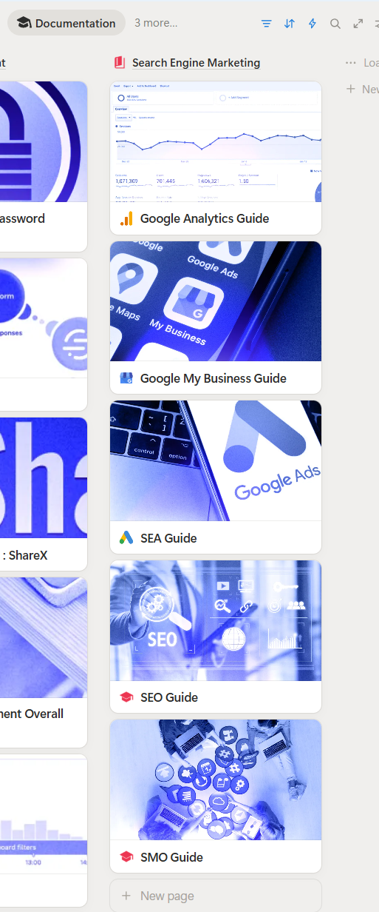
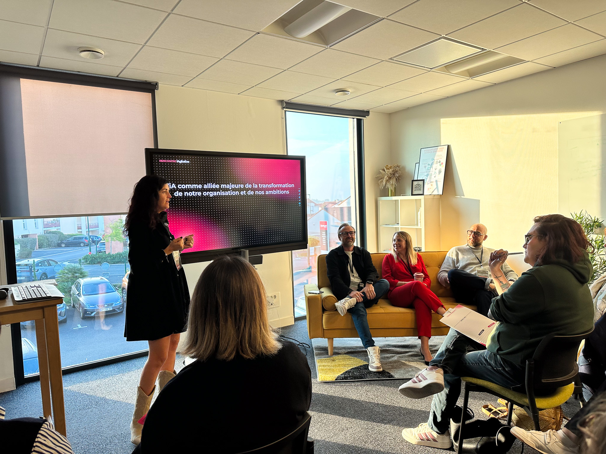
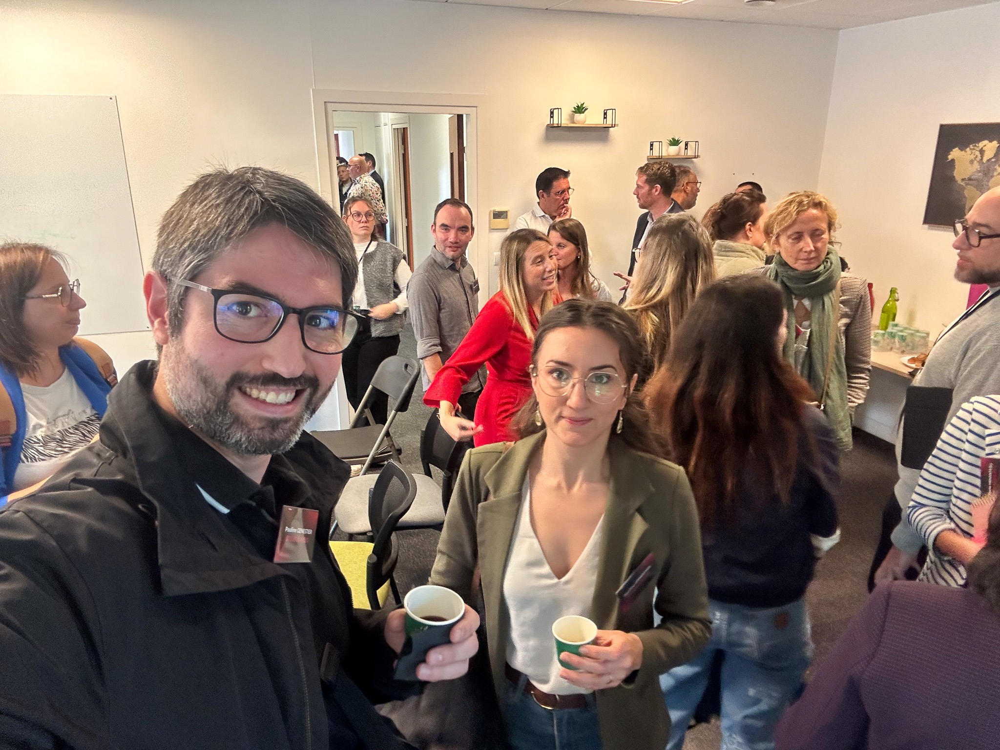

{: .post-image--half }

J’ai passé plusieurs semaines à apprendre le SEO pour livrer une stratégie à un client. Ce travail m’a fait réfléchir à la place qu’on lui donne dans la communication de nos jeux.

Je trouve qu’on lui accorde encore trop peu d’attention. Pourtant, il peut aider des joueurs qui cherchent déjà ce type d’expérience à découvrir notre jeu. Ça mérite qu’on se penche sur ce que nos pages leur racontent.

## Partir de ce que les joueurs cherchent

Ce que j’ai trouvé difficile, en tant que dev, c’est de me mettre à la place du public. Je peux connaître mon projet dans ses moindres détails sans savoir comment quelqu’un d’extérieur va le chercher.

Pour un jeu, la question est concrète : quels mots utiliserait une personne qui ne connaît pas encore son nom ? Elle peut s’intéresser à un genre, à une plateforme ou à une façon de jouer.

Ces pistes demandent à être vérifiées. Décrire ton jeu comme tu le fais entre développeurs ne suffit pas à savoir quelles recherches pourraient mener jusqu’à lui.

Je retrouve là le travail d’empathie dont je parlais dans ma [newsletter d’octobre](https://sh1.sendinblue.com/afi1wnjv5xpfe.html?t=1759567679919). Il faut sortir du projet un moment et se demander ce que l’autre personne essaie de trouver.

## Donner envie de découvrir le jeu

Une fois sur la page, le joueur doit pouvoir se faire une idée de l’expérience. Qu’est-ce qu’il va faire ? À quoi ressemble le jeu en action ? Où peut-il l’essayer ou en savoir plus ?

Pour relire ta page, regarde ce qui répond à ces questions. Une description peut expliquer le principe du jeu. Une séquence de gameplay peut montrer une action que le texte décrit mal. Un lien identifiable permet de poursuivre vers une démo ou une page de distribution, si elles existent.

Chaque élément a alors un rôle. La vidéo montre le jeu, le texte précise ce qu’on y fait et le lien indique la suite.

Le SEO concerne la découverte dans les moteurs de recherche. La page doit aussi aider le joueur à décider si l’expérience l’intéresse. Les deux sujets se rejoignent dans le contenu que tu lui proposes.

## Faire un essai sur une page et suivre les résultats

Dans ma newsletter, j’insistais sur la possibilité de mesurer et sur le droit de se tromper. C’est ce qui permet d’avancer quand ce travail paraît impalpable à première vue.

Sur ton site, tu peux commencer par une page et une question précise. Par exemple : est-ce qu’on comprend où essayer le jeu ? Choisis une modification en rapport avec cette question, puis note ce que tu changes et à quelle date.

Selon les données disponibles, tu pourras regarder si les visiteurs arrivent sur cette page et s’ils suivent le lien proposé. Une visite et un clic vers la démo ne racontent pas la même chose.

Une variation ne prouve pas, à elle seule, que ta modification en est la cause. Mais garder cette trace permet soit de valider, soit de revenir en arrière, selon le résultat observé.

Le fonctionnement paraît plus abordable de cette manière : essayer, suivre et ajuster (petit pas par petit pas).

## Les guides que j’ai partagés dans UGO

Pendant cet apprentissage, j’ai documenté mon travail dans Notion. J’ai ensuite partagé ces connaissances dans UGO pour aider d’autres studios à faire découvrir leurs jeux.

Je les ai découpé en huit guides :

- SEO Guide
- SEA Guide
- SMO Guide
- Google My Business Guide
- Website Creation Guide
- Content Creation Guide
- Google Analytics Guide
- Storytelling Guide

{: .post-image--half }

Tu souhaites y accéder? Elles sont inclus dans mon template Notion:  [UGO](https://www.notion.com/templates/ultimate-gamedev-organizer).

Je t’encourage à documenter toi-même les leçons que tu auras apprises et les processus qui en découlent.

## Le SEO reste-t-il utile avec les réponses générées par l’IA ?

Avec les réponses générées par l’IA, est-ce que tout ce travail de référencement sert encore à quelque chose ?

À cette période, j’ai assisté à la matinée IAgitative organisée par *COPYLOT*. Le GEO, la visibilité dans les réponses générées par l’IA, était le sujet d’une des interventions. J’ai aussi échangé avec les intervenants après les présentations et c’était plutôt encourageant.

{: .post-image--half }

{: .post-image--half }

Pour Google, les bonnes pratiques SEO restent pertinentes pour AI Overviews et AI Mode. Sa [documentation](https://developers.google.com/search/docs/appearance/ai-features) indique qu’aucune optimisation spéciale supplémentaire n’est nécessaire, et que l’affichage n’est pas garanti.

Cela donne un cadre pour Google. Les autres outils d’IA peuvent fonctionner différemment. Le GEO prolonge donc la réflexion sur la découverte de ton jeu, sans donner de recette universelle.

## Prêt à attirer plus de joueurs?

Sur la page de ton jeu, qu’est-ce qui pourrait aider un joueur à comprendre l’expérience et à poursuivre sa découverte ?

Dans MG News, je partage mes retours de studio, des ressources et ma veille XR. Pour recevoir les prochaines éditions, tu peux t’inscrire ci-dessous.



