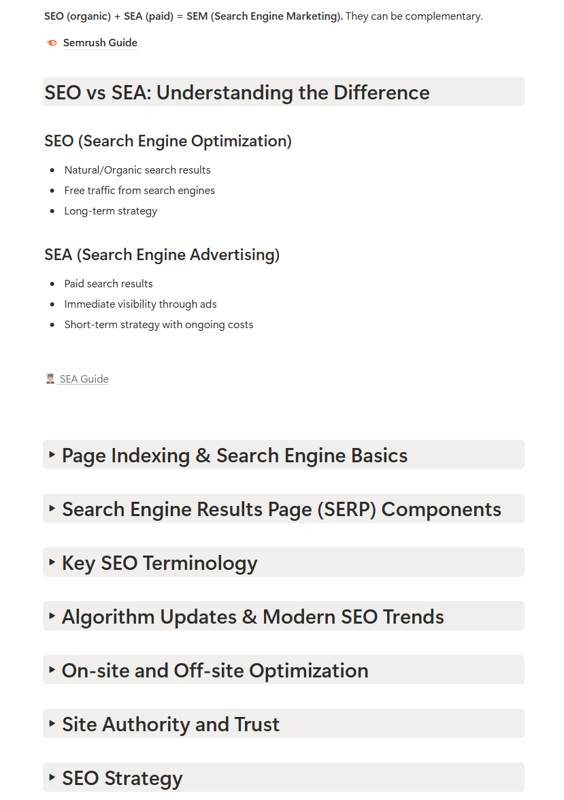

{: .post-image--half }

I spent several weeks learning SEO to deliver a strategy for a client. That work made me think about how much attention we give it when communicating about our games.

I think we still pay too little attention to it. Yet SEO can help players who are already looking for this kind of experience discover our game. It’s worth taking a closer look at what our pages tell them.

## Start with what players are looking for

As a developer, I found it difficult to put myself in my audience’s shoes. I can know my project inside out without knowing how someone unfamiliar with it might search for it.

For a game, the question is concrete: what words would someone use if they didn’t know its name yet? They might be interested in a genre, a platform or a particular way of playing.

These are starting points to check. Describing your game the way you would to other developers doesn’t tell you which searches might lead people to it.

That brings me back to the empathy I talked about in my [October newsletter](https://sh1.sendinblue.com/afi1wnjv5xpfe.html?t=1759567679919). We need to step away from our projects for a moment and ask what the other person is trying to find.

## Give players a reason to explore your game

Once players reach the page, they should be able to picture the experience. What will they do? What does the game look like in action? Where can they try it or learn more?

When reviewing your page, look for the elements that answer those questions. A description can explain the idea behind the game. Gameplay footage can show an action that is hard to describe in words. A clear link can lead to a demo or store page, if you have one.

Each element has a role. The video shows the game, the text explains what players do, and the link shows them where to go next.

SEO helps people discover your page through search engines. The page also needs to help players decide whether the experience interests them. The content you offer connects those two goals.

## Try a change on one page and follow the results

In my newsletter, I talked about being able to measure things and allowing ourselves to make mistakes. That makes it easier to move forward when this work feels abstract at first.

Start with one page on your site and one specific question. For example: is it clear where players can try the game? Choose a change related to that question, then note what you changed and when.

Depending on the data available, you can see whether visitors reach the page and whether they follow the link. A visit and a click through to a demo tell you different things.

A change in the numbers alone doesn’t prove that your edit caused it. Keeping a record does help you decide whether to keep the change or go back, based on what you observe.

The process feels more manageable this way: try, observe and adjust, one small step at a time.

## The guides I shared in UGO

During this learning process, I documented my work in Notion. I then shared what I learned in UGO to help other studios get their games discovered.

I organised it into eight guides:

- SEO Guide
- SEA Guide
- SMO Guide
- Google My Business Guide
- Website Creation Guide
- Content Creation Guide
- Google Analytics Guide
- Storytelling Guide

{: .post-image--half }

{: .post-image--half }

Want to explore them? They’re included in my Notion template, [UGO](https://www.notion.com/templates/ultimate-gamedev-organizer).

I also encourage you to write down what you learn and the processes that come out of it. Having those notes makes it easier to return to your work and build on it later.

## Is SEO still useful with AI-generated answers?

With AI-generated answers, is all this SEO work still useful?

Around that time, I attended the IAgitative event organised by COPYLOT. One of the talks covered GEO, or visibility in AI-generated answers. I also spoke with the speakers after the presentations and it was encouraging.

{: .post-image--half }

{: .post-image--half }

According to Google, SEO best practices still apply to AI Overviews and AI Mode. Its [documentation](https://developers.google.com/search/docs/appearance/ai-features) says no additional special optimisation is required, and appearing is not guaranteed.

That gives us a framework for Google. Other AI tools may work differently. GEO extends the question of how people discover your game, without offering a universal recipe.

## Ready to attract more players?

Looking at your game’s page, what could help a player understand the experience and continue exploring?

In MG News, I share what I’m learning at the studio, useful resources and XR news. To receive future editions, you can subscribe below.



